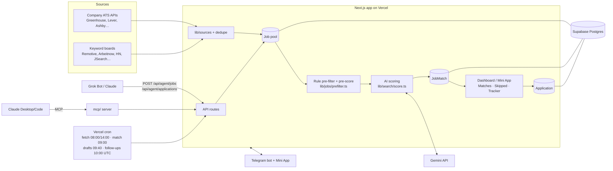

# Jobber

Jobber is a personal job-search assistant that runs as a Telegram Mini App and as a web dashboard. It pulls vacancies from public job boards and company ATS APIs, filters them with rules (no AI cost), scores the rest against your CV with AI, and keeps your applications in a tracker with follow-up reminders. Outside agents (Grok Bot, Claude) can send in jobs they find and read the tracker through a private API and MCP server.

## Why

Job hunting means checking dozens of boards, reading ads that don't fit, and losing track of follow-ups. Jobber does the boring part: one pool of jobs with duplicates removed, a score with reasons for each one, and a tracker that reminds you. Your decisions about what to apply for stay with you. Nothing is sent for you.

## Features

- **Matches**: scored vacancies (0–100), grouped by fit (strong / good / ok / weak), with reasons, red flags, a sub-score breakdown and requirement coverage. Local jobs rank ahead of remote ones in each band.
- **Skipped by filters**: every job the rules dropped, with the reason, plus a "Score anyway" button.
- **Job pool**: 20+ public sources (Greenhouse, Lever, Ashby, Workable, Personio, Recruitee, SmartRecruiters, Teamtailor, Workday, Remotive, Arbeitnow, HN "Who is hiring", JSearch…), deduped by normalized link and by company + title + location.
- **Tracker**: statuses (to apply → applied → interview → offer / rejected / skip), follow-up dates, a funnel with rates, employer reply parsing, interview `.ics`.
- **AI writing**: tailored CV advice, cover letters with versions, form drafts. A fact guard flags claims your CV and facts don't back.
- **Agent channel**: `POST /api/agent/jobs` puts an agent's finds into the pool (never the tracker), marks duplicates and queues them for scoring ahead of the pre-score cut.
- **Telegram**: sign in with Telegram, digest of strong matches, follow-up reminders, forwarding employer emails to the bot.
- **Cost control**: one shared Gemini free-tier key with per-user daily quotas and a global daily budget, or the user's own key.

## Stack

Next.js 16 (App Router, server components) · TypeScript · Prisma 5 on Supabase Postgres · Supabase Auth (email) + Telegram `initData` HMAC sign-in · Google Gemini (flash-lite) · grammY (Telegram bot) · Vercel (hosting + cron) · Tailwind + Radix UI · Vitest · MCP SDK.

## Architecture



## Agent API

Private API for the owner's agents. Auth: `Authorization: Bearer <AGENT_API_KEY>` (full access) or `AGENT_API_KEY_CLAUDE` (read-only unless `AGENT_API_KEY_CLAUDE_WRITE=true`). Keys must be at least 24 characters; with no key set the API answers 503. Everything acts on the owner account (`OWNER_TELEGRAM_ID`).

| Method | Path | What it does |
| --- | --- | --- |
| `POST` | `/api/agent/jobs` | One job (`{...}`) or up to 25 (`{items:[...]}`): `url`, or `text`, or `title` + `company` + `description` (≥150 chars), plus optional `location`, `remote`, `postedAt`, `source`, `note`, `score`. Stored in the pool, queued for scoring; one scoring request runs right away unless `score:false`. Each result has `status` (`created`/`duplicate`), `tracked` (tracker status or null) and `duplicate: {pool, tracker}`. |
| `GET` | `/api/agent/jobs?jobIds=a,b` | State of jobs sent earlier: `queued`, `skipped` (with reason) or `scored` (score, reasons, red flags, link). |
| `GET` | `/api/agent/applications` | Tracker list. Filters: `status`, `url`, `company`+`role`, `q`, `updatedSince`, `limit`. |
| `POST` | `/api/agent/applications` | Upsert one or up to 200 tracker rows, deduped by normalized URL, then company + role. |
| `GET`/`PATCH` | `/api/agent/applications/:id` | Read one; update `status`, `appliedAt`, `followUpAt`, `notes`, `appendNote`, `nextAction`. |
| `GET`/`POST` | `/api/agent/applications/:id/prepare` | Read / generate application-form drafts. Never submits. |

```bash
curl -s -X POST "$BASE/api/agent/jobs" -H "Authorization: Bearer $AGENT_API_KEY" -H 'content-type: application/json' \
  -d '{"url":"https://jobs.example.com/123","source":"grok","note":"React + Vienna"}'
```

MCP server for Claude: see [`mcp/README.md`](mcp/README.md).

## Screenshots

> Placeholders. Put images in `docs/screenshots/`.


Screens to capture:

1. Matches (desktop): fit groups + side panel with the selected match.
2. Match detail: score breakdown, requirements, red flags, agent note ("Found by Grok").
3. Skipped by filters: reasons + "Score anyway".
4. Tracker: list by status + funnel.
5. Application detail: follow-up date, reply parsing, cover letter versions.
6. Onboarding: CV upload → "Here's what I understood" card → search progress.
7. Telegram: Mini App in chat, digest message, follow-up reminder.
8. Agent API: a `curl` to `/api/agent/jobs` with its JSON response (duplicate flag).

## Environment variables

Required: `DATABASE_URL`, `DIRECT_URL`, `NEXT_PUBLIC_SUPABASE_URL`, `NEXT_PUBLIC_SUPABASE_ANON_KEY`, `SUPABASE_SERVICE_ROLE_KEY`, `ENCRYPTION_KEY`, `TELEGRAM_BOT_TOKEN`, `NEXT_PUBLIC_TELEGRAM_BOT_USERNAME`, `CRON_SECRET`, `NEXT_PUBLIC_APP_URL`, `GEMINI_API_KEY`.

Owner / demo: `OWNER_TELEGRAM_ID`, `SEED_INVITE_CODE`, `DEMO_MODE`, `TELEGRAM_MINI_APP_SHORT_NAME`.

Agent API / MCP: `AGENT_API_KEY`, `AGENT_API_KEY_CLAUDE`, `AGENT_API_KEY_CLAUDE_WRITE`, `MCP_URL_TOKEN`, `AGENT_DRAFTS`, `AGENT_DRAFTS_ALL`, `AGENT_DRAFTS_MIN_SCORE`, `AGENT_DRAFTS_PER_DAY`.

AI tuning (optional): `GEMINI_API_KEYS`, `GEMINI_MODEL`, `GEMINI_MODEL_LITE`, `GEMINI_FLASH_FALLBACK`, `GEMINI_RPM_LITE`, `GEMINI_RPM_SMART`, `GEMINI_RPD_LITE`, `AI_DAILY_SCORE_CALLS`, `AI_DAILY_SCORES`, `AI_PRESCORE_MIN`, `AI_TOP_CANDIDATES`, `FIRST_STEP_MS`, `MAX_RUN_SOURCES`.

Sources (optional): `JSEARCH_API_KEY`, `JSEARCH_HOST`, `JSEARCH_KEYWORDS`, `JSEARCH_MONTHLY_LIMIT`, `JSEARCH_SOURCE`, `ADZUNA_APP_ID`, `ADZUNA_APP_KEY`, `JOOBLE_API_KEY`, `HN_SOURCE`, `OWNER_SCRAPERS`, `SCRAPER_*` (owner-only scrapers).

Setup details for each are below.

## Feature details


- Sign-in from Telegram WebApp `initData`, checked with HMAC-SHA256 and the bot token. `auth_date` older than 24 hours is rejected. A signed cookie is the session. The owner is the Telegram account in `OWNER_TELEGRAM_ID`, or the first account that opens the app with the seed invite. Email magic link still works in a normal browser.
- Profile: PDF text extraction, skills, location and salary filters, skill gaps, writing rules, company watchlist.
- Pluggable sources with real parsers: Greenhouse, Ashby, Lever, Workable, Personio, Recruitee, SmartRecruiters, RSS/Teamtailor, and the public Remotive API. HTML-only and Join.com pages are stored but not fetched.
- Deduping the same company + title + location across sources.
- Daily Vercel cron: fetch a few sources per run, then score a few new vacancies per user, then send Telegram follow-ups. Progress for the fetch loop is stored in `CronJob`.
- Match scores (0–100), reasons, and red flags. Daily digest to Telegram for scores of 70+.
- CV-first onboarding (`/dashboard/onboarding`): upload a PDF or paste text → Gemini extracts a structured profile (validated with zod) → the user edits a "Here's what I understood" card → Jobber builds a search plan (titles, keywords, and companies picked **only** from `lib/companies/seed.json`, a curated list of boards verified to return jobs by `scripts/verify-seed.mjs`) → the first fetch + score runs immediately in small steps (`/api/search/step`), with a progress card. A Telegram message with the top matches goes out when the first run finishes.
- Keyword boards without a watchlist: Remotive, Jobicy, Himalayas (search API) and Arbeitnow (keyword-filtered).
- Rule pre-filter before any AI call (`lib/jobs/prefilter.ts`): title/role family, seniority, German-language requirements, on-site city, region-locked remote.
- AI (`lib/ai/run.ts` → `gemini.ts`): **flash-lite does everything** (`GEMINI_MODEL_LITE`, default `gemini-3.5-flash-lite`: CV reading, search plan, scoring, advice, letters). Flash (`GEMINI_MODEL`) is only a fallback for “smart” work when `GEMINI_FLASH_FALLBACK=true`. Sliding-window limiter per key+model (`GEMINI_RPM_LITE`=15), RetryInfo backoff on 429, cross-instance backoff row.
- Shared daily budget (`lib/ai/budget.ts`, table `GlobalAiUsage`, Pacific-time day like Google): `GEMINI_RPD_LITE`=500, `GEMINI_RPD_FLASH`=20, safety margin `GEMINI_RPD_MARGIN`=20, `GEMINI_ONBOARDING_RESERVE`=80 kept for CV reading + plans of new users. Atomic `insert … on conflict … where count < cap`.
- Optional own Gemini key per user (Settings → illustrated “How to get a free Gemini key” guide). Checked with the free `models.list` call, stored AES-256-GCM encrypted in `ApiKey` (provider `gemini`). When present: user's own quota, no shared budget, bigger limits.
- Per-user daily limits in AI *requests* (`AiUsage`): shared key `AI_DAILY_SCORE_CALLS`=6 (one request scores up to 5 jobs → 30 jobs/day), `AI_DAILY_WRITES`=4, `AI_DAILY_CV_PARSES`=5; own key `AI_BYO_DAILY_SCORE_CALLS`=80, `AI_BYO_DAILY_WRITES`=60, `AI_BYO_DAILY_CV_PARSES`=20. ~10 requests per active user/day → ~40 active users on the free 500 RPD.
- Guided profile form (`lib/profile/draft.ts`, `components/profile-form.tsx`): field, job titles, city/country + open to (city / country / remote / relocation), languages with plain levels, level + “stretch roles”, contract type, salary, things/companies to avoid. CVs prefill it; the form is the source of truth and everything stays editable in Profile (plus keywords, skills, scoring rules, min score, max job age, Telegram alert frequency/threshold).
- Multiple labelled CVs (`Cv` table, `/api/cvs`). Scoring sends all CVs and the AI picks the best one per job (shown as “CV: …” on matches); advice / tailored CV / letter use the chosen CV, switchable on the match page.
- Location tiers (`lib/jobs/prefilter.ts#locationTier`): city → country → remote → relocation. Sources are fetched in that order, local jobs are scored first, and matches are sorted by tier inside each fit band.
- Scoring rubric (`lib/search/rubric.ts`): AI gives role fit + skills (calibrated anchors, few-shot), code gives seniority (incl. stretch + “N+ years”), location tier, language, salary → weighted 30/30/15/10/7/8, low role fit caps the total. Breakdown is shown on each match.
- Filters you can see: “Skipped by filters” lists every job the rules dropped (with reasons) and a “Score anyway” button.
- Companies to watch: AI-picked from the verified dataset (`lib/companies/seed.json`, 128 companies, tagged with real cities/countries from their open jobs) plus any company by name or careers URL — ATS auto-detected (`lib/companies/detect.ts`).
- "Tailor CV" on each match: concrete emphasise/add/reword suggestions, missing keywords, and a "don't claim" list; optional tailored CV text. Cached per user+job on `JobMatch`.
- Database changes: run `supabase/migrations/002_shared_ai_onboarding.sql`, then `supabase/migrations/003_guided_form_multi_cv.sql` in the Supabase SQL editor (both idempotent).
- Application tracker with statuses and a 7-day follow-up date.
- Ideas from [AienTech/dossier](https://github.com/AienTech/dossier), rewritten for Jobber (database: run `supabase/migrations/006_profile_facts.sql` once):
  - "Facts about me" in Profile: true things that aren't in the CV (start date, work permit, salary, links), one per line. Letters, form drafts, follow-ups and reply drafts use them; nothing about the owner is hard-coded.
  - Fact guard (`lib/ai/fact-guard.ts`, no AI call): names, numbers, links and credentials in a letter, draft, tailored CV or follow-up that the CV, facts and job post don't back are shown as "Check before sending".
  - Requirement matching (`lib/search/requirements.ts`): the scoring call also lists each job's key requirements and which of your skills each is about; code decides covered / partial / gap from your skills and CVs, blends that into the Skills sub-score and shows it on the match. The model can't add a skill by naming it.
  - Trust nothing from the model: CV advice keeps only rewordings that quote the real CV, drops "missing" keywords the CV has, and always lists the code-found gaps under "Don't claim". Job and email texts are marked as material, not instructions.
  - Prompt versions (`lib/ai/meta.ts`): each letter, CV advice, tailored CV and draft remembers which prompt wrote it; older ones say so and can be rewritten.
  - Cover letter versions: every rewrite keeps the previous letter (last 12), with Restore. Tap a paragraph to rewrite only that one; refine by a note or by chips built from the match ("Lead with React", "Address “German C1” honestly"). Hand edits are saved too.
  - Employer replies: forward an email to the bot (or paste it on an application): one AI call reads what it is (rejection / interview / question / offer / confirmation), which application, what they ask and a confirmed interview time, then the tracker is updated (status, dated note, next action) with an Undo button, and a draft answer comes back.
  - Hacker News "Who is hiring?" as a keyword board (`lib/sources/hackernews.ts`, public Algolia API, `HN_SOURCE=off` to disable). Existing users get it the next time they save their profile.
  - "Write it with Claude" (owner, with the MCP connector): opens a claude.ai chat that reads the match with `get_match` / `get_profile` and saves the letter with `save_cover_letter` (fact-checked, kept in versions). New MCP tools: `get_profile`, `list_matches`, `get_match`, `save_cover_letter`.
  - Dedupe by link too: the same posting found through two boards (or with tracking parameters) is stored once (`Job.urlKey`).
  - Sharper scoring: the scorer reads each ad's requirements and tasks sections (`lib/search/digest.ts`) instead of the first 1200 characters (usually the company blurb); German/English levels are compared as CEFR (A1–C2) against what the ad asks and whether it's optional; and your own recent tracker decisions (applied, interview, skipped) calibrate role fit (`lib/search/calibration.ts`).
  - Agent drafts (`lib/agent/drafts.ts`, cron `/api/cron/agent-drafts` at 09:40 UTC): cover letters for the best new matches (score ≥ 75, at most `AGENT_DRAFTS_PER_DAY`=3), fact-checked and marked "Letter ready", with a Telegram note. Never sent. Owner by default (`AGENT_DRAFTS=off` to stop); users with their own Gemini key when `AGENT_DRAFTS_ALL=true`.
  - Vacancies from an agent (`POST /api/agent/jobs`, `lib/agent/jobs.ts`): the Grok bot (or Claude) sends what it found; Jobber stores it once in the job pool (deduped by link, then company + title + place), queues it for scoring ahead of the pre-score cut, and shows it in Matches with the agent's note. The tracker only gets what the owner decides. See `mcp/README.md`.
  - Funnel on the tracker: applied → reply → interview → offer with rates, 30/90 days/all, and applications per week.
  - SSRF-safe fetching of user links (`lib/net/safe-fetch.ts`): public addresses only (checked after DNS), every redirect re-checked, standard ports, size and time limits.
  - Interviews to the calendar: when a reply settles a time, the bot and the tracker offer "Add to Google Calendar" and an `.ics` file (`/api/applications/[id]/interview.ics`).
  - LinkedIn, Indeed & more through JSearch (Google for Jobs, `lib/sources/jsearch.ts`): each user adds their own free OpenWeb Ninja or RapidAPI key in Settings (encrypted in `ApiKey`, provider `jsearch`), or the owner uses `JSEARCH_API_KEY`. Two keywords per user, fetched at most once a day, capped at `JSEARCH_MONTHLY_LIMIT` (180) requests a month; the employer's own apply link is preferred, and the match shows "via LinkedIn".
- `/start` sends an Open Jobber button and sets the chat menu button to the Mini App. An invite can arrive as `/start CODE` or as `startapp` on the t.me link.
- Local demo mode when Supabase is not configured, so the screens can be clicked through with sample matches.

## Job sources

All public and used per their terms; no LinkedIn or logged-in scraping. Re-check live with `npx tsx scripts/verify-sources.mts`; rebuild the company list with `node scripts/verify-seed.mjs`.

- Keyword boards: JSearch (Google for Jobs: LinkedIn, Indeed…, own key), Remotive, Jobicy, Himalayas, Arbeitnow, RemoteOK (link back required), We Work Remotely (RSS), Working Nomads, The Muse, Bundesagentur für Arbeit Jobsuche API (Germany, local search), Adzuna (`ADZUNA_APP_ID`/`ADZUNA_APP_KEY`, free key, optional), Jooble (`JOOBLE_API_KEY`, free key, optional).
- Company ATS boards: Greenhouse, Lever, Ashby, Workable, Personio, Recruitee, SmartRecruiters, Teamtailor, BambooHR, Workday (public CXS endpoint).
- Not included: AMS eJob-Room / karriere.at (no public API or feed; AMS search API needs login), EURES (no public API), LinkedIn, Join.com (public API needs a numeric company id).


## What is stubbed

- Sources marked `html` or `join` in the watchlist have no adapter. The cron records that on the source row instead of scraping the page.
- SmartRecruiters stores the list payload (title, location, url). The long description needs a second request and is not fetched yet.
- There is no separate `/link` step. Opening the Mini App is the account.
- Profile editing of an uploaded CV is replace-only. There is no rich CV editor.
- Demo mode keeps data in the server process. It is for clicking through the UI, not a second database.

## Setup

### 1. Install

```bash
npm install
```

### 2. Supabase

1. Create a project at [supabase.com](https://supabase.com).
2. In **Authentication → Providers → Email**, keep email enabled. Magic links are the login method.
3. In **Authentication → URL configuration**, add `https://<your-domain>/auth/callback` and `http://127.0.0.1:43123/auth/callback`.
4. Copy the project URL, anon key, and service role key.
5. In **Project Settings → Database**, copy both pooler strings (see the next section). Prisma Client talks to the transaction pooler. The session pooler string still belongs in `DIRECT_URL` because `prisma generate` reads it. The tables themselves are created by pasting `supabase/setup.sql` in the SQL Editor, not by `prisma db push`.

### 3. Environment

```bash
cp .env.example .env.local
```

| Variable | Purpose |
| --- | --- |
| `DATABASE_URL` | Supabase transaction pooler, port 6543, with `?pgbouncer=true`. Prisma Client uses this for every query |
| `DIRECT_URL` | Supabase session pooler, port 5432. Prisma reads this at `prisma generate`. The schema is applied from `supabase/setup.sql`, not from a database connection |
| `NEXT_PUBLIC_SUPABASE_URL` | Supabase project URL |
| `NEXT_PUBLIC_SUPABASE_ANON_KEY` | Browser auth key |
| `SUPABASE_SERVICE_ROLE_KEY` | Reserved for server tasks. Not used by the browser |
| `ENCRYPTION_KEY` | 64 hex chars. `openssl rand -hex 32` |
| `TELEGRAM_BOT_TOKEN` | From BotFather |
| `CRON_SECRET` | Random string. Vercel sends it as `Authorization: Bearer …` |
| `NEXT_PUBLIC_APP_URL` | Public origin, no trailing slash. Locally `http://127.0.0.1:43123` |
| `DEMO_MODE` | `false` once Supabase is set. `true` forces sample data |
| `OWNER_TELEGRAM_ID` | Numeric Telegram id of the owner. That account opens the app without an invite and is the only one who can mint invites. Leave empty to use the seed invite instead |
| `SEED_INVITE_CODE` | Optional. Otherwise the seed script prints a random code. The first Telegram user who opens the app with this code is the owner when `OWNER_TELEGRAM_ID` is empty |

Generate the two secrets:

```bash
openssl rand -hex 32   # ENCRYPTION_KEY
openssl rand -hex 32   # CRON_SECRET
```

### 4. Database

The Supabase database starts empty, and this project does not open a Postgres connection to push the schema. In the Supabase **SQL Editor**, paste `supabase/setup.sql` and run it once.

That file is the full schema from:

```bash
npx prisma migrate diff --from-empty --to-schema-datamodel prisma/schema.prisma --script
```

followed by the row level security statements in `supabase/migrations/001_initial_schema.sql`. Tables and indexes are created only when they are missing, existing foreign keys are left in place, and each policy is dropped and recreated, so pasting it again does not duplicate them. Do not run `001_initial_schema.sql` on its own afterward. It is already included, and by itself it expects the tables to exist.

The script does not insert an invite code. Set `OWNER_TELEGRAM_ID` to your numeric Telegram id. That account is the owner and can open the Mini App without an invite.

`DATABASE_URL` is the transaction pooler (`:6543/postgres?pgbouncer=true`). The Next.js server uses it and bypasses RLS. The policies stop the public Supabase API from reading another user's rows. `ApiKey`, invite codes, and cron rows have RLS on and no client policy, so the browser cannot select them. `DIRECT_URL` stays set because `prisma generate` reads it. Queries do not use it.

### 5. Your profile (kept out of git)

`seed-data/` is gitignored.

```bash
mkdir -p seed-data
# copy your profile markdown, writing rules, and optional watchlist:
# seed-data/alexander_profile.md
# seed-data/job_search_rules.md
# seed-data/company_watchlist.json
```

If the watchlist file is missing, the script uses `examples/company_watchlist.json` (public career URLs only).

```bash
npm run seed
```

The script prints an invite code and seeds job sources. It does not create an email account. Set `OWNER_TELEGRAM_ID` to your numeric Telegram id and the script writes the local profile onto that Telegram user. If the id is empty, open the Mini App with the printed invite first, then run the seed again so the profile lands on that account.

### 6. Telegram Mini App

`NEXT_PUBLIC_APP_URL` must be HTTPS before Telegram will open it. `http://127.0.0.1` is only for the browser demo.

1. Talk to [@BotFather](https://t.me/botfather) and send `/newbot`. Put the token in `TELEGRAM_BOT_TOKEN`. The same token validates Mini App `initData`.
2. Send `/newapp`, pick the bot, and set the Web App URL to `https://YOUR_DOMAIN/dashboard/matches`. Note the short name. Put the bot username in `NEXT_PUBLIC_TELEGRAM_BOT_USERNAME` and the short name in `TELEGRAM_MINI_APP_SHORT_NAME`.
3. Web sign-in uses the bot too (no Login Widget, no `/setdomain`): “Sign in with Telegram” opens `t.me/<bot>?start=login_<token>`, the user taps “Yes, sign me in”, and the web tab signs in by itself (the bot also sends a one-time link for other browsers).
4. Optional: `/setmenubutton` with the same URL and the text `Open`. `/start` also sets that menu button for the chat.
4. `/setcommands`:

```
start - Open Jobber
help - Show commands
matches - Recent scores
profile - Profile summary
reminders - Follow-ups that are due
```

5. After deploy, set the webhook:

```bash
curl -X POST "https://api.telegram.org/bot$TELEGRAM_BOT_TOKEN/setWebhook" \
  -H "Content-Type: application/json" \
  -d '{"url":"https://YOUR_DOMAIN/api/telegram"}'
```

Invite links look like `https://t.me/<bot>/<shortname>?startapp=CODE`. `/start CODE` also passes the code into the button URL. The owner is `OWNER_TELEGRAM_ID`, or, when that is empty, the first Telegram user who opens the app with the seed invite. Only the owner can mint further invites. Everyone else needs a code.

### 7. Your model key

Settings → paste a key for OpenAI, Anthropic, Gemini, or xAI.

Pasting a key does not leave the Mini App.

### 8. Vercel

`vercel.json` schedules:

- `08:00 UTC` `/api/cron/fetch-jobs` — 5 companies per invocation, then continues next run
- `09:00 UTC` `/api/cron/match-jobs` — up to 5 users, 10 unscored jobs each
- `10:00 UTC` `/api/cron/follow-ups` — Telegram reminders

Set every variable from `.env.local` in the Vercel project, including `DATABASE_URL`, `DIRECT_URL`, and `CRON_SECRET`. `prisma generate` reads both database URLs from the schema even though queries only use `DATABASE_URL`. Vercel Cron must send `Authorization: Bearer $CRON_SECRET`. If your project does not inject that header, add a rewrite or a cron proxy that does. The routes reject anything else.

### 9. Run locally

```bash
npm run dev
```

The dev server listens on [http://127.0.0.1:43123](http://127.0.0.1:43123).

Without Supabase variables the app stays in demo mode: sample matches, a sample letter, and forms that write to memory for this process.

## Tests

```bash
npm test
npm run typecheck
npm run build
```

Tests cover AES-GCM roundtrip, salary and ATS parsers (Greenhouse, Ashby, Lever, Workable, Personio, Recruitee, Remotive, RSS, SmartRecruiters), dedupe keys, and the match/cover-letter prompt plus JSON parsing. They do not call live job boards or model APIs.

## Project map

- `app/(dashboard)` — Matches, Tracker, Profile, Settings
- `app/api/telegram` — grammY webhook
- `app/api/cron` — fetch, match, follow-up
- `lib/sources` — one parser per ATS
- `lib/llm` — provider client, scoring, letters
- `lib/crypto` — AES-256-GCM
- `prisma/schema.prisma` — tables
- `scripts/seed-profile.ts` — local profile + watchlist
- `examples/company_watchlist.json` — public example watchlist
